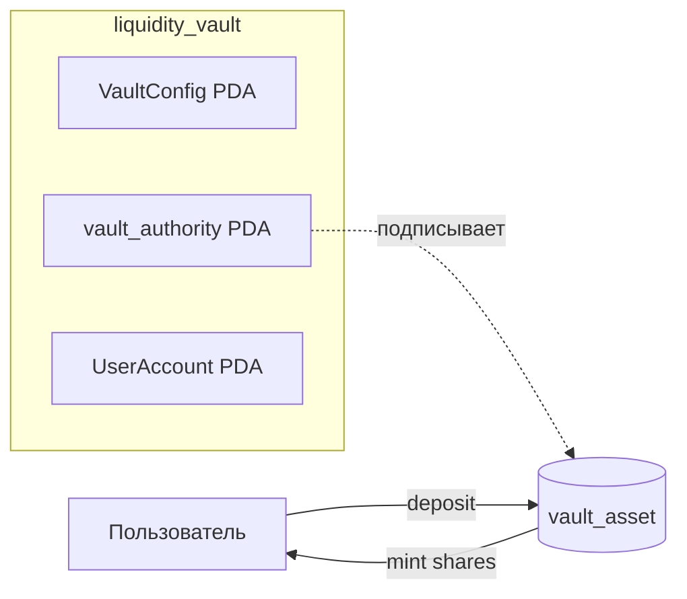

# Liquidity Vault

Сквозной проект курса (недели 8–13): DeFi-vault на Anchor, который принимает токены пользователей, выдаёт share-токены и размещает ликвидность в CLMM-пуле Raydium.



## Аккаунты

| Аккаунт | Seeds | Назначение |
|---|---|---|
| `VaultConfig` | `["config", asset_mint]` | настройки vault: admin, mint-ы, `total_assets`, `total_shares`, лимит, пауза |
| `vault_authority` | `["authority", config]` | system-owned PDA без данных, владелец share mint и token accounts, подписывает CPI |
| `share_mint` | `["shares", config]` | mint share-токенов, `decimals` = decimals актива |
| `vault_asset` | `["vault_asset", config]` | token account vault с депозитным активом |
| `UserAccount` | `["user", config, owner]` | PDA пользователя: статистика депозитов/выводов |

## Инструкции

| Неделя | Инструкция | Кто вызывает |
|---|---|---|
| 8 | `initialize_vault(deposit_cap, authority_lamports)` | admin |
| 8 | `init_user()` | пользователь |
| 8 | `update_settings(paused, deposit_cap)` | admin |

## Запуск

Требования: Rust, Solana CLI 3.x, Anchor CLI 1.0.2, Node.js 20+, Yarn.

```bash
cd liquidity-vault
yarn install
anchor build
anchor keys sync      # подставит ваш Program ID в lib.rs и Anchor.toml
anchor test           # поднимет локальный валидатор и прогонит tests/
```

Деплой в devnet:

```bash
solana config set --url devnet
solana airdrop 2
anchor deploy --provider.cluster devnet
```
