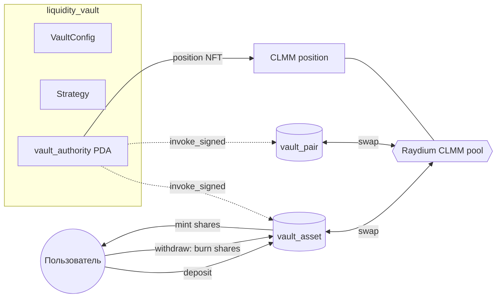

# Liquidity Vault

Сквозной проект курса (недели 8–13): DeFi-vault на Anchor, который принимает токены пользователей, выдаёт share-токены и размещает ликвидность в CLMM-пуле Raydium.



## Аккаунты

| Аккаунт | Seeds | Назначение |
|---|---|---|
| `VaultConfig` | `["config", asset_mint]` | admin, mint-ы, `total_assets`, `total_shares`, лимит, пауза |
| `vault_authority` | `["authority", config]` | system-owned PDA без данных: владелец share mint, token accounts и NFT позиции, подписывает все CPI, платит rent за позицию |
| `share_mint` | `["shares", config]` | mint share-токенов, `decimals` = decimals актива |
| `vault_asset` | `["vault_asset", config]` | token account vault с депозитным активом |
| `UserAccount` | `["user", config, owner]` | PDA пользователя: статистика депозитов/выводов |
| `Strategy` | `["strategy", config]` | пул Raydium CLMM, второй mint пары, `asset_is_token_0`, текущая позиция |
| `vault_pair` | `["vault_pair", config]` | token account vault для второго токена пары |

## Инструкции

| Неделя | Инструкция | Кто вызывает |
|---|---|---|
| 8 | `initialize_vault(deposit_cap, authority_lamports)` | admin |
| 8 | `init_user()` | пользователь |
| 8 | `update_settings(paused, deposit_cap)` | admin |
| 9 | `deposit(amount, min_shares_out)` | пользователь |
| 10 | `withdraw(shares, min_assets_out)` | пользователь |
| 11 | `set_strategy()` — привязка к CLMM-пулу Raydium | admin |
| 12 | `swap(amount_in, min_amount_out, sqrt_price_limit_x64, asset_to_pair)` — CPI `swap_v2` | admin |
| 13 | `open_position(...)`, `collect_fees()`, `decrease_liquidity(...)`, `close_position()` | admin |
| 13 | `check_range(require_out_of_range)` | кто угодно (keeper) |
| 13 | `report_assets(new_total_assets)` — переоценка, ±20% | admin |

## Структура

```
liquidity-vault/
├── programs/liquidity-vault/src/
│   ├── lib.rs                 # точки входа инструкций
│   ├── state.rs               # VaultConfig, UserAccount, Strategy
│   ├── math.rs                # доли, диапазоны, лимиты (unit-тесты)
│   ├── constants.rs · errors.rs · events.rs
│   └── instructions/
│       ├── initialize_vault.rs · init_user.rs · admin.rs   # нед. 8, 13
│       ├── deposit.rs                                      # нед. 9
│       ├── withdraw.rs                                     # нед. 10
│       ├── set_strategy.rs                                 # нед. 11
│       ├── swap.rs                                         # нед. 12
│       └── position.rs                                     # нед. 13
├── tests/liquidity-vault.ts   # localnet: каркас, deposit, withdraw, report_assets
└── scripts/                   # devnet: токены, пул, swap, позиция, rebalance
```

## Запуск

Требования: Rust, Solana CLI 3.x, Anchor CLI 1.0.2, Node.js 20+, Yarn.

```bash
cd liquidity-vault
yarn install
anchor build
anchor keys sync      # подставит ваш Program ID в lib.rs и Anchor.toml
anchor build
```

Тесты:

```bash
cargo test -p liquidity-vault --lib math   # математика долей и диапазонов
anchor test                                 # localnet: инструкции недель 8–10, 13
```

Devnet (недели 11–13). Скрипты используют Raydium SDK v2 и пишут адреса в `scripts/state.json`:

```bash
solana config set --url devnet && solana airdrop 2
anchor deploy --provider.cluster devnet

yarn w11:tokens        # два тестовых токена
yarn w11:pool          # CLMM-пул Raydium
yarn w11:seed          # стартовая ликвидность в пул
yarn w11:vault         # initialize_vault → set_strategy → init_user → deposit
yarn w12:swap 4000 50 a2b
yarn w13:open 5
yarn w13:fees
yarn w13:rebalance 5
yarn w13:report
```

## Безопасность
- Все PDA проверяются через `seeds` + сохранённый `bump`, связи — через `has_one`.
- Деньги vault двигает только `vault_authority` через `invoke_signed`; NFT позиции тоже у него.
- Расчёты в `u128` с проверкой переполнения, округление в пользу vault; донат на `vault_asset` не меняет цену доли.
- Проскальзывание: `min_shares_out`, `min_assets_out`, `min_amount_out` (swap запрещён без него), `amount_*_min` при выводе ликвидности.
- Вывод не блокируется паузой; выдаётся только свободный остаток.
- Перестановка атомарна: `check_range` первой инструкцией транзакции.
