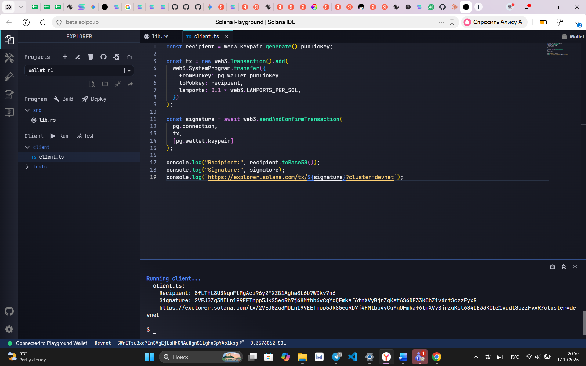
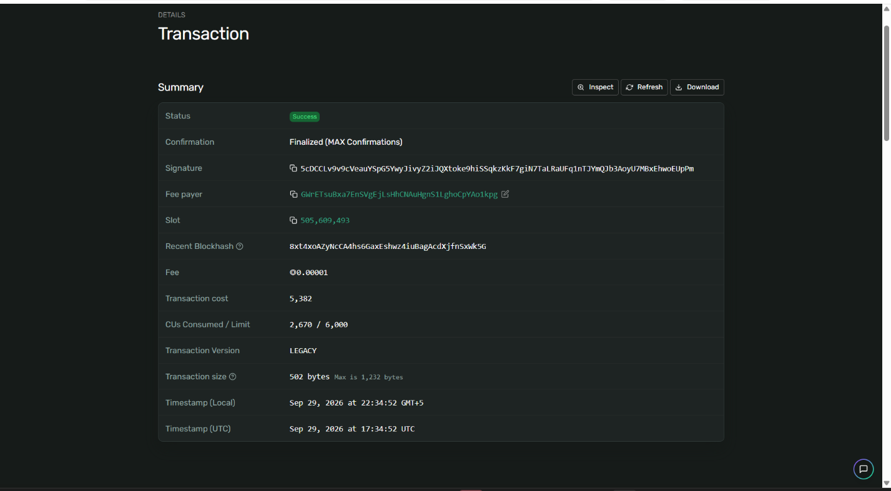
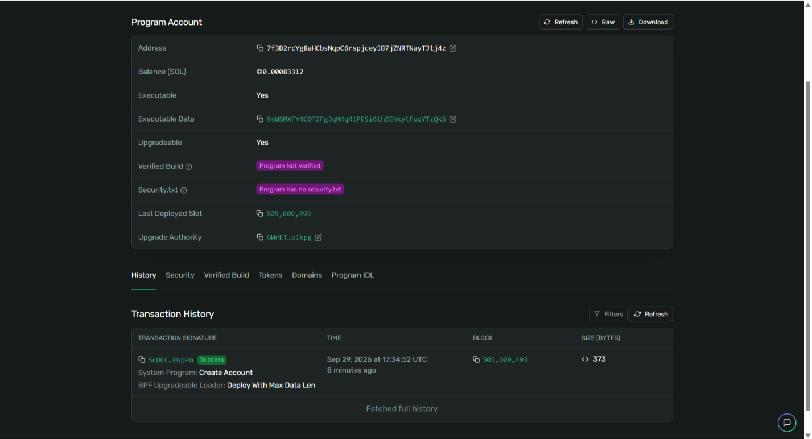
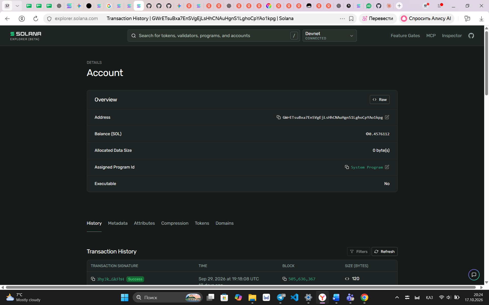

# Неделя 1: Вход в Web3. Первая транзакция в Solana

**Результат обучения:** РО1
**Сеть:** Solana Devnet

## Цель
Создать кошелёк, получить тестовый SOL, отправить первую транзакцию, найти и разобрать её в Solana Explorer.

## Ход работы
1. Создан кошелёк (Playground Wallet) в Solana Playground, сеть Devnet.
2. Получен тестовый баланс 2.5 SOL (faucet).
3. Выполнена транзакция деплоя программы в Devnet, результат найден в Solana Explorer.
4. Отправлен первый перевод SOL (скрипт [client/transfer.ts](client/transfer.ts)), см. раздел ниже.

## Данные
| Параметр | Значение |
|---|---|
| Кошелёк (fee payer) | [GWrETsuBxa7EnSVgEjLsHhCNAuHgnS1LghoCpYAo1kpg](https://explorer.solana.com/address/GWrETsuBxa7EnSVgEjLsHhCNAuHgnS1LghoCpYAo1kpg?cluster=devnet) |
| Program ID | [7f3D2rcYg8aHCbsNqpC6rspjceyJB7jZNRTNayTJtj4z](https://explorer.solana.com/address/7f3D2rcYg8aHCbsNqpC6rspjceyJB7jZNRTNayTJtj4z?cluster=devnet) |
| Сеть | Devnet |

## Транзакция деплоя
- Signature: `5cDCCLv9v9cVeauYSpG5YwyJivyZ2iJQXtoke9hiSSqkzKkF7giN7TaLRaUFq1nTJYmQJb3AoyU7MBxEhwoEUpPm`
- [Открыть в Explorer](https://explorer.solana.com/tx/5cDCCLv9v9cVeauYSpG5YwyJivyZ2iJQXtoke9hiSSqkzKkF7giN7TaLRaUFq1nTJYmQJb3AoyU7MBxEhwoEUpPm?cluster=devnet)

| Поле | Значение |
|---|---|
| Status | Success, Finalized |
| Fee payer | GWrETsuB...Ao1kpg |
| Slot | 505,609,493 |
| Fee | 0.00001 SOL |
| CU Consumed / Limit | 2,670 / 6,000 |
| Version / Size | LEGACY, 502 bytes |
| Время | 29.09.2026, 17:34:52 UTC |

## Первый перевод SOL
Перевод выполнен скриптом [client/transfer.ts](client/transfer.ts) в Solana Playground (Devnet).

| Поле | Значение |
|---|---|
| Отправитель | GWrETsuBxa7EnSVgEjLsHhCNAuHgnS1LghoCpYAo1kpg |
| Получатель | 8fLTHL8U3NqnFtMgAci96y2FXZB1Agha8L6b7WDkv7n6 |
| Сумма | 0.1 SOL |
| Комиссия | 0.000005 SOL |
| Signature | 2VEJGZq3MDLn199EETnpp5JkS5eoRb7j4HMtbb4vCgYgQFmkaf6tnXVyBjrZgKst6S4DE33KCbZ1vddtSczzFyxR |
| Explorer | [открыть транзакцию](https://explorer.solana.com/tx/2VEJGZq3MDLn199EETnpp5JkS5eoRb7j4HMtbb4vCgYgQFmkaf6tnXVyBjrZgKst6S4DE33KCbZ1vddtSczzFyxR?cluster=devnet) |

## Скриншоты

[← К списку работ](../README.md)
