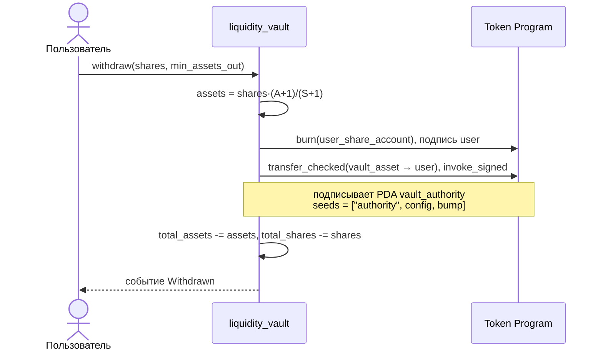

# Неделя 10: CPI и вывод из vault

**Тема:** share-токены сжигаются, vault возвращает токены пользователю через Token program с подписью PDA
**Результат обучения:** РО3
**Сеть:** Localnet / Solana Devnet · **Среда:** Anchor CLI 1.0.2

## Ход работы
1. В [`math.rs`](../liquidity-vault/programs/liquidity-vault/src/math.rs) добавлена `assets_for_shares` и тест «депозит → вывод никогда не даёт прибыли».
2. Реализована инструкция [`withdraw(shares, min_assets_out)`](../liquidity-vault/programs/liquidity-vault/src/instructions/withdraw.rs).
3. Добавлены ошибки `InsufficientShares`, `InsufficientIdleLiquidity` и событие `Withdrawn`.
4. Тесты: частичный вывод, вывод больше баланса, проскальзывание, полный вывод на паузе.

## Как работает вывод



## CPI с подписью PDA
У PDA нет приватного ключа, поэтому подписать перевод из `vault_asset` может только сама программа. Anchor делает это через `CpiContext::new_with_signer`, под капотом — `invoke_signed`: рантайм пересчитывает адрес из переданных seeds и program id, и если он совпадает с аккаунтом-подписантом, подпись считается действительной.

```rust
let config_key = config.key();
let authority_seeds: &[&[u8]] = &[AUTHORITY_SEED, config_key.as_ref(), &[config.authority_bump]];
transfer_checked(
    CpiContext::new_with_signer(
        ctx.accounts.token_program.key(),
        TransferChecked { from: vault_asset, mint: asset_mint, to: user_asset_account, authority: vault_authority },
        &[authority_seeds],
    ),
    assets,
    decimals,
)?;
```

Две CPI в одной инструкции подписаны по-разному:

| CPI | Кто подписывает | Почему |
|---|---|---|
| `burn` share-токенов | пользователь (`Signer`) | доли на его кошельке |
| `transfer_checked` из vault | PDA `vault_authority` (`invoke_signed`) | vault принадлежит программе |

## Безопасность
- Сначала сжигаем доли, потом отдаём актив — порядок «effects → interactions», учёт обновляется в той же атомарной транзакции.
- Округление вниз в пользу vault: тест `deposit_then_withdraw_never_profits` проверяет, что на округлении нельзя заработать.
- `min_assets_out` — пользователь задаёт минимум, который готов получить.
- Вывод **не** блокируется паузой — средства пользователя никогда не «запираются».
- `InsufficientIdleLiquidity`: на неделе 13 часть актива уйдёт в пул Raydium; вывод возможен только из свободного остатка.

## Проверка
```bash
cd liquidity-vault/programs/liquidity-vault && cargo test --lib math   # 8 passed
cd ../.. && anchor test                                                  # deposit + withdraw
```

## Данные деплоя
| Параметр | Значение |
|---|---|
| Program ID | _после `anchor deploy`_ |
| withdraw tx | _после запуска клиента_ |

[← К списку работ](../README.md)
