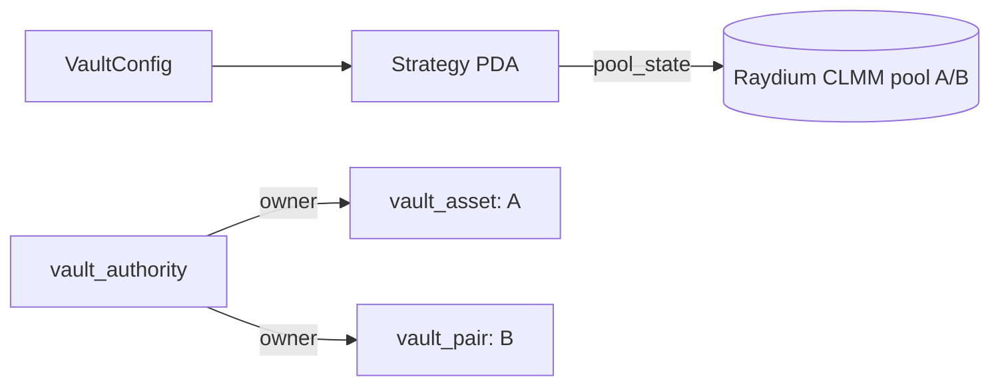

# Неделя 11: AMM и концентрированная ликвидность (Raydium CLMM)

**Тема:** как работают пулы ликвидности и ценовые диапазоны; свои тестовые токены и CLMM-пул Raydium в devnet
**Результат обучения:** РО3
**Сеть:** Solana Devnet · **Raydium CLMM (devnet):** [`DRayAUgENGQBKVaX8owNhgzkEDyoHTGVEGHVJT1E9pfH`](https://explorer.solana.com/address/DRayAUgENGQBKVaX8owNhgzkEDyoHTGVEGHVJT1E9pfH?cluster=devnet)

## Теория

### Классический AMM (x·y = k)
Пул хранит два токена в резервах `x` и `y`. Произведение после обмена остаётся постоянным: `x·y = k`. Цена = `y / x`. Ликвидность «размазана» по всем ценам от 0 до ∞, поэтому большая часть капитала почти никогда не используется.

### Концентрированная ликвидность (CLMM)
Провайдер ликвидности (LP) выбирает **ценовой диапазон** `[P_lower, P_upper]`. Внутри диапазона позиция работает как обычный `x·y = k`, но с «виртуальными» резервами — тот же капитал даёт гораздо большую глубину рынка.

| Где цена | Что в позиции | Комиссии |
|---|---|---|
| ниже `P_lower` | только token_0 | не зарабатывает |
| внутри диапазона | оба токена | зарабатывает |
| выше `P_upper` | только token_1 | не зарабатывает |

### Тики и цена
- Цена дискретна: `price = 1.0001^tick` (каждый тик ≈ 0.01%).
- В пуле хранится `sqrt_price_x64 = √price · 2^64` (fixed-point Q64.64) и `tick_current`.
- `tick_spacing` (например 60 для комиссии 0.25%) — границы позиции должны быть кратны ему.
- Тики сгруппированы в **tick arrays** по 60 штук; при swap и открытии позиции их адреса передаются как аккаунты.
- Позиция в Raydium — это NFT (Token-2022) + PDA `personal_position` с `tick_lower`, `tick_upper`, `liquidity` и накопленными комиссиями.

### Порядок токенов
Raydium сортирует mint-ы побайтово: `token_mint_0 < token_mint_1`. Поэтому vault хранит флаг `asset_is_token_0` и сам решает, какой из его token accounts соответствует token_0.

## Ход работы
| Шаг | Скрипт | Что делает |
|---|---|---|
| 1 | [`01-create-tokens.ts`](../liquidity-vault/scripts/01-create-tokens.ts) | два SPL-токена (6 decimals), по 1 000 000 на кошелёк |
| 2 | [`02-create-clmm-pool.ts`](../liquidity-vault/scripts/02-create-clmm-pool.ts) | CLMM-пул A/B через Raydium SDK v2, комиссия 0.25%, цена 1 |
| 3 | [`03-seed-liquidity.ts`](../liquidity-vault/scripts/03-seed-liquidity.ts) | стартовая ликвидность 100 000 A в диапазоне 0.5–2.0 |
| 4 | [`04-init-vault.ts`](../liquidity-vault/scripts/04-init-vault.ts) | `initialize_vault` → `set_strategy` → `init_user` → `deposit` |

```bash
cd liquidity-vault && yarn install
yarn w11:tokens
yarn w11:pool          # или: yarn ts-node scripts/02-create-clmm-pool.ts 1.0
yarn w11:seed
anchor build && anchor deploy --provider.cluster devnet
yarn w11:vault
```

## Изменения в программе
- Подключён CPI-адаптер [`raydium-clmm-cpi`](https://github.com/raydium-io/raydium-cpi) (Anchor 1.0.2, фича `devnet`).
- Новый аккаунт [`Strategy`](../liquidity-vault/programs/liquidity-vault/src/state.rs) — PDA `["strategy", config]`: пул, второй mint, `vault_pair`, `asset_is_token_0`, `tick_spacing`.
- Инструкция [`set_strategy`](../liquidity-vault/programs/liquidity-vault/src/instructions/set_strategy.rs) (только admin):
  - `pool_state: AccountLoader<PoolState>` — Anchor проверяет, что владелец аккаунта — программа Raydium CLMM;
  - пул обязан торговать именно `asset_mint` против `pair_mint`, иначе `InvalidPool`;
  - создаётся `vault_pair` — token account второго токена, владелец `vault_authority`.



## Результаты (devnet)
| Объект | Адрес / tx |
|---|---|
| Token A | _из вывода `01-create-tokens.ts`_ |
| Token B | _из вывода `01-create-tokens.ts`_ |
| CLMM pool | _из вывода `02-create-clmm-pool.ts`_ |
| create pool tx | _…_ |
| seed liquidity tx | _…_ |
| set_strategy tx | _…_ |

[← К списку работ](../README.md)
