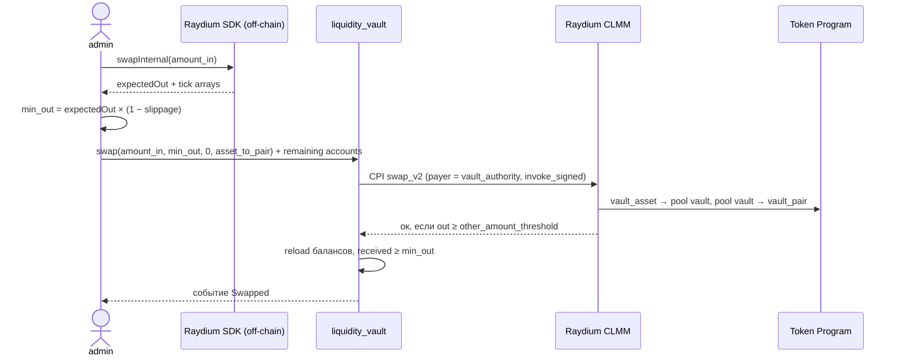

# Неделя 12: Swap через Raydium

**Тема:** обмен токенов из vault через CLMM-пул Raydium с ограничением на минимальную сумму получения (slippage)
**Результат обучения:** РО3
**Сеть:** Solana Devnet · **Среда:** Anchor CLI 1.0.2 + Raydium SDK v2

## Ход работы
1. Реализована инструкция [`swap(amount_in, min_amount_out, sqrt_price_limit_x64, asset_to_pair)`](../liquidity-vault/programs/liquidity-vault/src/instructions/swap.rs) — CPI в `raydium_clmm::swap_v2`.
2. Добавлены ошибка `SlippageNotSet` и событие `Swapped`.
3. Клиент [`05-vault-swap.ts`](../liquidity-vault/scripts/05-vault-swap.ts): симуляция swap в SDK → расчёт `min_amount_out` → вызов vault.

## Поток swap



## Защита от проскальзывания — в два слоя
1. **Raydium**: `other_amount_threshold = min_amount_out` при `is_base_input = true` — пул сам откатит swap, если выход меньше порога.
2. **Vault**: после CPI программа перечитывает (`reload()`) свои token accounts и проверяет фактически полученную сумму. Swap с `min_amount_out = 0` запрещён (`SlippageNotSet`).

Дополнительно можно ограничить цену через `sqrt_price_limit_x64` (0 = граничная цена по направлению).

## Как устроен вызов
| Аккаунт | Откуда | Кто проверяет |
|---|---|---|
| `config`, `strategy`, `vault_asset`, `vault_pair` | PDA vault | vault (`seeds`, `has_one`) |
| `pool_state` | `strategy.pool_state` | vault (`has_one`) + owner = Raydium |
| `amm_config`, `observation_state`, pool vaults | данные пула | Raydium |
| tick arrays (+ bitmap extension) | `remaining_accounts` из симуляции SDK | Raydium |

`payer` в Raydium — это `vault_authority`: он владелец входного token account, поэтому подписывает через `CpiContext::new_with_signer`.

Направление выбирается флагом `asset_to_pair`; клиент переводит его в `zeroForOne` с учётом `strategy.asset_is_token_0` (Raydium сортирует mint-ы).

Swap меняет состав активов vault, но не учётную стоимость `total_assets` — переоценка делается на неделе 13 (`report_assets`).

## Запуск
```bash
cd liquidity-vault
anchor build && anchor deploy --provider.cluster devnet
yarn ts-node scripts/05-vault-swap.ts 1000 50 a2b   # 1000 A → B, допуск 0.5%
yarn ts-node scripts/05-vault-swap.ts 200 50 b2a    # 200 B → A
```

Проверка защиты: запуск с заведомо завышенным `min_amount_out` (например slippage `-100`) должен упасть с ошибкой Raydium `TooLittleOutputReceived`.

## Результаты (devnet)
| Операция | tx |
|---|---|
| swap A → B | _из вывода `05-vault-swap.ts`_ |
| swap B → A | _…_ |

[← К списку работ](../README.md)
