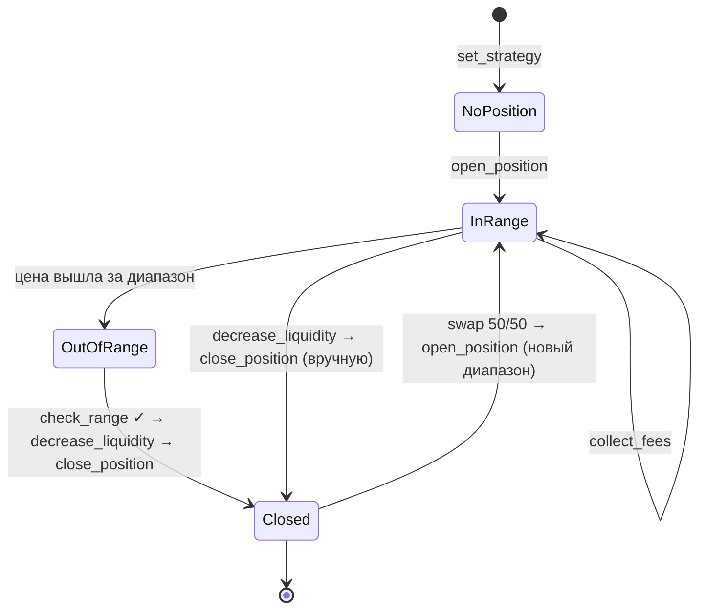

# Неделя 13: Позиция в CLMM-пуле Raydium

**Тема:** открыть из vault позицию в выбранном ценовом диапазоне, собрать комиссии, закрыть позицию и переставить её при выходе цены из диапазона
**Результат обучения:** РО3
**Сеть:** Solana Devnet · **Среда:** Anchor CLI 1.0.2 + Raydium SDK v2

## Ход работы
1. В `Strategy` добавлено состояние позиции: `has_position`, `position_nft_mint`, `tick_lower`, `tick_upper`.
2. Реализованы инструкции в [`position.rs`](../liquidity-vault/programs/liquidity-vault/src/instructions/position.rs):

| Инструкция | CPI в Raydium | Что делает |
|---|---|---|
| `open_position(...)` | `open_position_with_token22_nft` | позиция в диапазоне `[tick_lower, tick_upper)`, NFT у `vault_authority` |
| `collect_fees()` | `decrease_liquidity_v2(liquidity = 0)` | комиссии → token accounts vault |
| `decrease_liquidity(liquidity, min_0, min_1)` | `decrease_liquidity_v2` | ликвидность + комиссии → vault, с защитой min |
| `close_position()` | `close_position` | сжигает NFT, rent → `vault_authority` |
| `check_range(require_out_of_range)` | — | сравнивает `pool.tick_current` с диапазоном |
| `report_assets(new_total_assets)` | — | переоценка NAV vault, не более ±20% за раз |

3. В [`math.rs`](../liquidity-vault/programs/liquidity-vault/src/math.rs) — `tick_in_range` и `within_bps` с тестами (10 unit-тестов всего).
4. Скрипты: [`06-open-position.ts`](../liquidity-vault/scripts/06-open-position.ts), [`07-collect-fees.ts`](../liquidity-vault/scripts/07-collect-fees.ts), [`08-rebalance.ts`](../liquidity-vault/scripts/08-rebalance.ts), [`09-report-assets.ts`](../liquidity-vault/scripts/09-report-assets.ts); общая логика — [`position-lib.ts`](../liquidity-vault/scripts/position-lib.ts), swap вынесен в [`swap-lib.ts`](../liquidity-vault/scripts/swap-lib.ts).

## Жизненный цикл позиции



## Ключевые решения

**Кто владеет позицией.** NFT позиции выпускается на `vault_authority` (PDA). Только программа может подписать за него, значит управлять ликвидностью можно только через инструкции vault, а не напрямую в Raydium.

**Кто платит rent.** `vault_authority` — system-owned PDA без данных, поэтому он может быть `payer` в CPI: Raydium создаёт через него NFT mint, ATA, `personal_position` и tick arrays. SOL на это кладётся при `initialize_vault(authority_lamports)`; при `close_position` rent возвращается обратно.

**Сопоставление token_0/token_1.** Raydium сортирует mint-ы, поэтому программа по `strategy.asset_is_token_0` подставляет `vault_asset`/`vault_pair` на места `token_account_0/1` и `recipient_token_account_0/1`.

**Проверка аккаунтов.** `personal_position` проверяется как PDA `["position", nft_mint]` программы Raydium (`seeds::program = clmm_program`), а `nft_mint` — через `has_one = position_nft_mint` в `Strategy`. Подменить позицию нельзя.

**Атомарная перестановка.** Транзакция keeper-а начинается с `check_range(require_out_of_range = true)`. Если цена вернулась в диапазон, пока транзакция шла в сеть, ошибка `PositionInRange` откатит и вывод ликвидности, и закрытие.

**Учёт стоимости.** Пока средства лежат в пуле и во втором токене, `total_assets` не равен балансу `vault_asset`. Admin считает NAV off-chain (`09-report-assets.ts`) и пишет через `report_assets`; ограничение ±20% защищает от ошибки или злоупотребления. Вывод пользователей идёт только из свободного остатка (`InsufficientIdleLiquidity`).

## Перестановка (rebalance)
```
tx1: check_range(true) → decrease_liquidity(вся ликвидность, min −1%) → close_position
swap: выравниваем стоимость token_0 / token_1 ≈ 50/50 (vault.swap, slippage 1%)
tx2: open_position(±rangePct% вокруг текущей цены)
```

## Запуск (devnet)
```bash
cd liquidity-vault
anchor build && anchor deploy --provider.cluster devnet
yarn w12:swap 4000 50 a2b      # часть A → B, чтобы в vault были оба токена
yarn w13:open 5                # позиция ±5%
yarn w12:swap 500 50 b2a       # обмены создают комиссии
yarn w13:fees                  # собрать комиссии
yarn w12:swap 9000 300 a2b     # увести цену из диапазона
yarn w13:rebalance 5           # переставить позицию
yarn w13:report                # переоценить NAV
```

## Проверка
- `cargo test --lib math` — 10 passed (`range_bounds`, `report_bounds` и др.)
- `anchor test` — сценарии `report_assets` и `InsufficientIdleLiquidity` на localnet (Raydium не нужен).

## Результаты (devnet)
| Операция | tx |
|---|---|
| open_position | _из вывода `06-open-position.ts`_ |
| collect_fees | _…_ |
| rebalance: decrease + close | _…_ |
| rebalance: open (новый диапазон) | _…_ |
| report_assets | _…_ |

[← К списку работ](../README.md)
