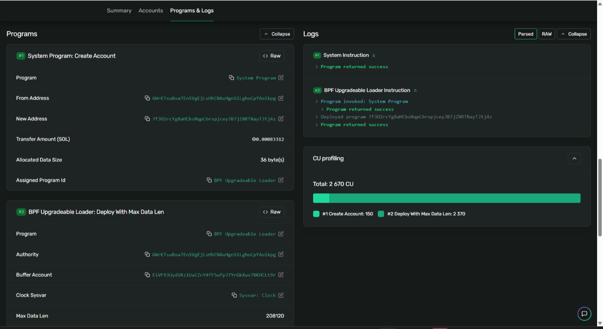

# Неделя 2: Как на самом деле работает Solana (Transaction Detective)

**Результат обучения:** РО1
**Сеть:** Solana Devnet

## Цель
Разобрать реальные транзакции Solana и определить accounts, instructions и programs.

## Анализируемые транзакции
| № | Транзакция | Ссылка |
|---|-----------|--------|
| A | Деплой программы (неделя 1) | [5cDCCLv9...EUpPm](https://explorer.solana.com/tx/5cDCCLv9v9cVeauYSpG5YwyJivyZ2iJQXtoke9hiSSqkzKkF7giN7TaLRaUFq1nTJYmQJb3AoyU7MBxEhwoEUpPm?cluster=devnet) |
| B | Counter: initialize (неделя 5) | [32ZbJVmh...PQ3oM1](https://explorer.solana.com/tx/32ZbJVmhoJ4yH1EVLc9AixiUiSQ8ErSjxd83pne8XfyeAEtiQguDNfcDQbTi9JSvrPvZT4UFF1jtp8HfysPQ3oM1?cluster=devnet) |
| C | Counter: increment (неделя 5) | [4RhTikaN...Gp8Zs8](https://explorer.solana.com/tx/4RhTikaNGkvfkayLuHx5iTEYDYn6GZLWss7mJPZkaLwb7QZKo23neCNn68iorMcBCdau6MbASYiLeR6SuYGp8Zs8?cluster=devnet) |

## Транзакция A: деплой программы
**Accounts**

| Роль | Адрес |
|---|---|
| Fee payer / Authority (signer) | GWrETsuBxa7EnSVgEjLsHhCNAuHgnS1LghoCpYAo1kpg |
| Новый аккаунт (будущая программа) | 7f3D2rcY...Jtj4z (writable) |
| Buffer Account | временный аккаунт с кодом программы |
| Sysvar: Clock | системный аккаунт времени |

**Instructions**
1. **System Program: Create Account**: создаёт аккаунт программы (0.00083312 SOL, 36 байт), владелец назначается BPF Upgradeable Loader.
2. **BPF Upgradeable Loader: Deploy With Max Data Len**: превращает аккаунт в исполняемую программу (Max Data Len 208120).

**Programs:** System Program, BPF Upgradeable Loader.
**Итог:** Success, 2,670 CU, fee 0.00001 SOL, 502 bytes, slot 505,609,493.

## Транзакция B: Counter initialize
- Fee payer и signer: кошелёк `FA1jAQejPWcRRGcLUCrznsUupgX2ZZcoEi5Rtap2hZth`; вторым signer-ом выступает новый keypair счётчика (`.signers([counterKp])` в client.ts), поэтому комиссия 0.00001 SOL (две подписи).
- Accounts (по коду): `counter` (создаётся), `user` (плательщик), `systemProgram`.
- Instructions: создание аккаунта через System Program и вызов `initialize` программы Counter.
- Programs: System Program, Counter (`2v92GpF5...6LXfg`).
- Итог: Success, 5,923 CU, 308 bytes, slot 507,981,877.

## Транзакция C: Counter increment
- Одна подпись, комиссия 0.000005 SOL.
- Accounts (по коду): `counter` (writable), `authority` (signer).
- Instruction: `increment` программы Counter, значение счётчика растёт на 1.
- Итог: Success, 1,697 CU, 211 bytes, slot 507,981,888.

## Выводы
- Транзакция состоит из подписей, списка accounts и одной или нескольких instructions.
- Каждая instruction вызывает конкретную программу и перечисляет аккаунты, с которыми она работает (writable/signer).
- Комиссия зависит от числа подписей (0.000005 SOL за подпись).
- Программа деплоится через System Program и BPF Upgradeable Loader, а обычные вызовы идут напрямую в пользовательскую программу.

## Скриншоты

[← К списку работ](../README.md)
