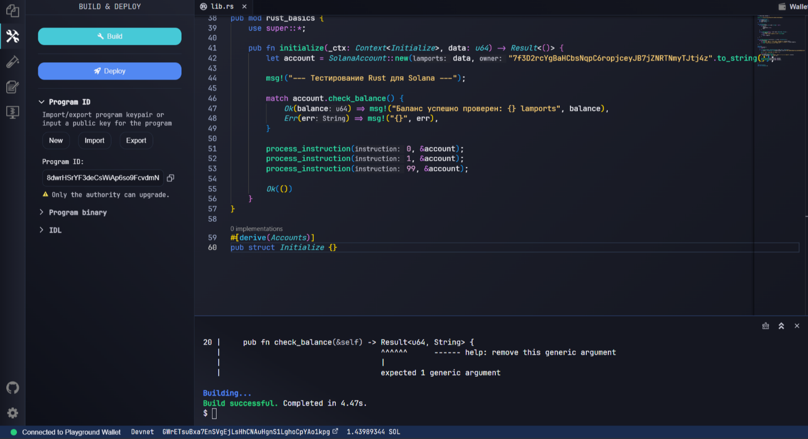

# Неделя 3: Rust для Solana-разработчика

**Результат обучения:** РО2

## Цель
Создать небольшую CLI-программу на Rust с конструкциями, которые понадобятся в Solana-разработке.

## Программа
CLI «Solana Account CLI»: учёт аккаунтов и балансов в lamports (создание, перевод, баланс, список).
Код: [src/main.rs](src/main.rs).

## Использованные конструкции Rust
| Конструкция | Где в коде | Аналог в Solana |
|---|---|---|
| `struct` | `Account`, `Ledger` | структуры аккаунтов (`#[account]`) |
| `enum` с данными | `LedgerError` | `#[error_code]` пользовательские ошибки |
| `Result<T, E>` и оператор `?` | `create`, `balance`, `transfer` | возвращаемый тип инструкций `Result<()>` |
| `match` и pattern matching по срезу | `execute` | разбор инструкций и аккаунтов |
| `impl` и трейт `Display` | `Ledger`, `LedgerError` | методы структур и сообщения об ошибках |
| `HashMap`, `Vec`, итераторы | `Ledger.accounts`, `list` | коллекции данных |
| Заимствование (`&`, `&mut`) | везде | работа с `ctx.accounts` |

## Запуск
```bash
cd week3
cargo run                         # интерактивный режим
cargo run < demo_input.txt        # готовый сценарий
```

## Результат запуска
Вывод `cargo run < demo_input.txt` (сценарий из [demo_input.txt](demo_input.txt)):

```
Solana Account CLI. Введите help для списка команд.
> Создан аккаунт alice (5000 lamports)
> Создан аккаунт bob (1000 lamports)
> Баланс alice: 5000 lamports
> Переведено 1500 lamports: alice -> bob
> Ошибка: недостаточно средств: нужно 99999, доступно 2500
> Ошибка: аккаунт "carol" не найден
> Ошибка: аккаунт "alice" уже существует
> Ошибка: неверная сумма: "abc"
>   alice      3500 lamports
  bob        2500 lamports
  Всего: 6000 lamports
> Выход.
```

Сценарий проверяет создание аккаунтов, перевод, а также ошибки: недостаточно средств, несуществующий аккаунт, повторное создание, неверная сумма.

## Скриншот работы в Solana Playground
Ранее в Playground был также собран программный модуль с теми же конструкциями (struct, Result, match), сборка успешна:



[← К списку работ](../README.md)
