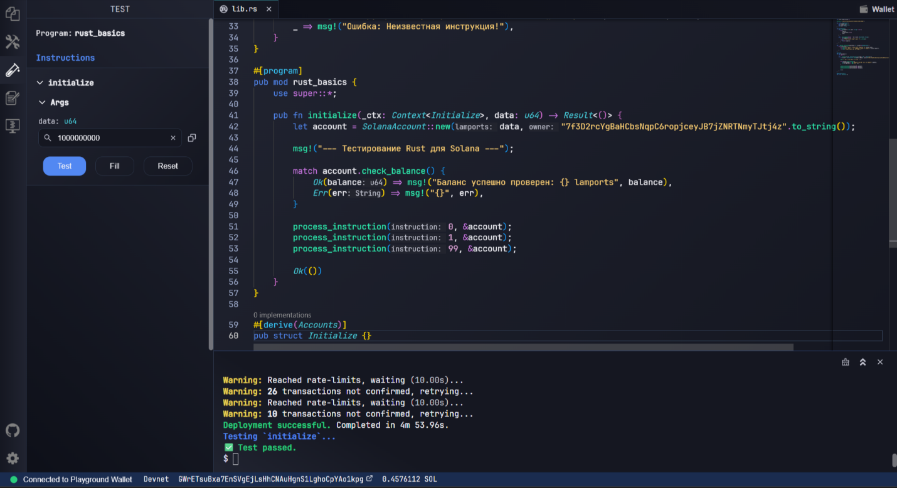

# Неделя 4: Первая Solana Program

**Результат обучения:** РО2
**Сеть:** Solana Devnet

## Цель
Создать и задеплоить первую Solana Program в Devnet.

## Ход работы
1. В Solana Playground создан проект `rust_basics` (Anchor).
2. Программа собрана (Build) и задеплоена (Deploy) в Devnet.
3. Через вкладку Test вызвана инструкция `initialize` с аргументом `data = 1000000000`.
4. В терминале подтверждены `Deployment successful` и `Test passed`.

## Данные деплоя
| Параметр | Значение |
|---|---|
| Проект | rust_basics |
| Program ID | [8dwrHSrYF3deCsWiAp6so9FcvdmNBdJ3shbbWL58QQgD](https://explorer.solana.com/address/8dwrHSrYF3deCsWiAp6so9FcvdmNBdJ3shbbWL58QQgD?cluster=devnet) |
| Кошелёк (deployer) | [GWrETsuBxa7EnSVgEjLsHhCNAuHgnS1LghoCpYAo1kpg](https://explorer.solana.com/address/GWrETsuBxa7EnSVgEjLsHhCNAuHgnS1LghoCpYAo1kpg?cluster=devnet) |
| Сеть | Devnet |

## Что делает программа
`initialize` создаёт структуру `SolanaAccount`, проверяет баланс через `match` и вызывает `process_instruction` для инструкций 0, 1 и 99. Неизвестная инструкция (99) обрабатывается веткой `_`.

Код: [src/lib.rs](src/lib.rs)

## Результат
Деплой завершён успешно (4 мин 53 сек), тест `initialize` пройден.

[← К списку работ](../README.md)
