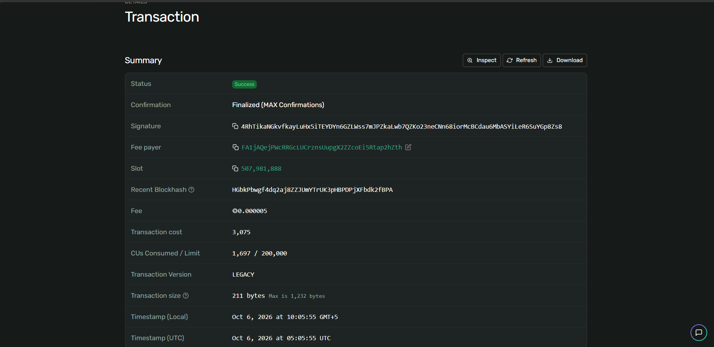
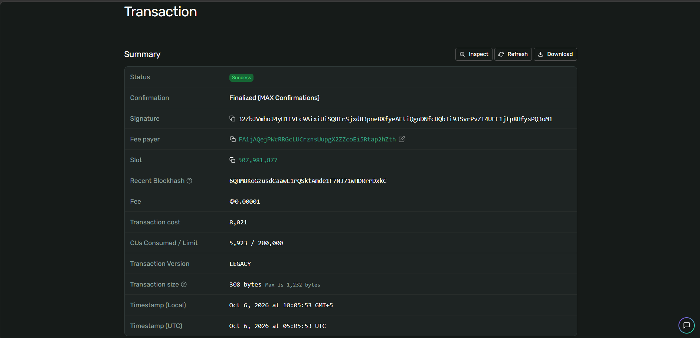
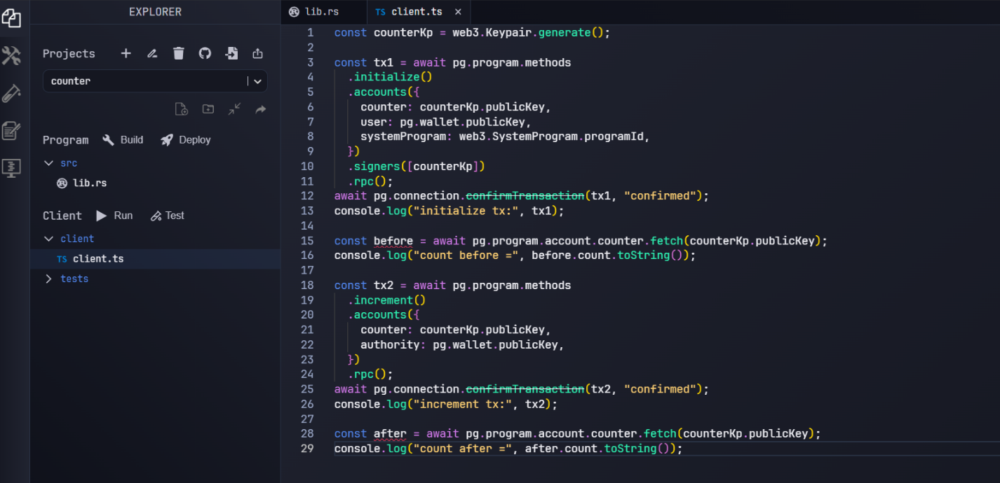

# Неделя 5: Anchor Framework. Counter Program

**Результат обучения:** РО2
**Сеть:** Solana Devnet

## Цель
Создать Counter Program и взаимодействовать с ней через client.

## Ход работы
1. В Solana Playground создан Anchor-проект `counter`.
2. Написана программа с инструкциями `initialize` и `increment`; выполнены Build и Deploy.
3. Клиент `client.ts` (TypeScript) создаёт keypair счётчика, вызывает `initialize`, читает значение, вызывает `increment` и читает значение снова.
4. Транзакции проверены в Solana Explorer.

## Данные
| Параметр | Значение |
|---|---|
| Program ID | [2v92GpF5iXQi82UfN77LBPkWEQapt1Vc35JQu9s6LXfg](https://explorer.solana.com/address/2v92GpF5iXQi82UfN77LBPkWEQapt1Vc35JQu9s6LXfg?cluster=devnet) |
| Кошелёк | [FA1jAQejPWcRRGcLUCrznsUupgX2ZZcoEi5Rtap2hZth](https://explorer.solana.com/address/FA1jAQejPWcRRGcLUCrznsUupgX2ZZcoEi5Rtap2hZth?cluster=devnet) |
| Сеть | Devnet |

## Транзакции
- initialize: [32ZbJVmh...PQ3oM1](https://explorer.solana.com/tx/32ZbJVmhoJ4yH1EVLc9AixiUiSQ8ErSjxd83pne8XfyeAEtiQguDNfcDQbTi9JSvrPvZT4UFF1jtp8HfysPQ3oM1?cluster=devnet)
- increment: [4RhTikaN...Gp8Zs8](https://explorer.solana.com/tx/4RhTikaNGkvfkayLuHx5iTEYDYn6GZLWss7mJPZkaLwb7QZKo23neCNn68iorMcBCdau6MbASYiLeR6SuYGp8Zs8?cluster=devnet)

## Результат
Значение счётчика изменилось с 0 на 1, что подтверждает работу логики программы и хранения состояния в аккаунте.

Код: [src/lib.rs](src/lib.rs) · [client/client.ts](client/client.ts)

## Скриншоты

[← К списку работ](../README.md)
