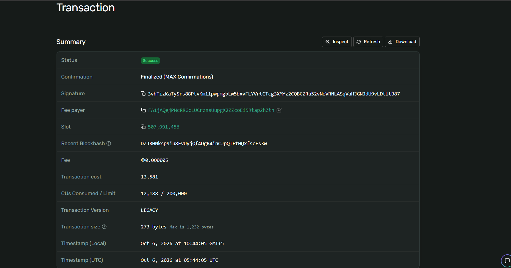
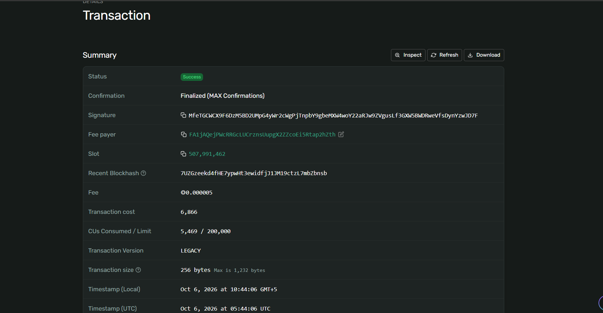
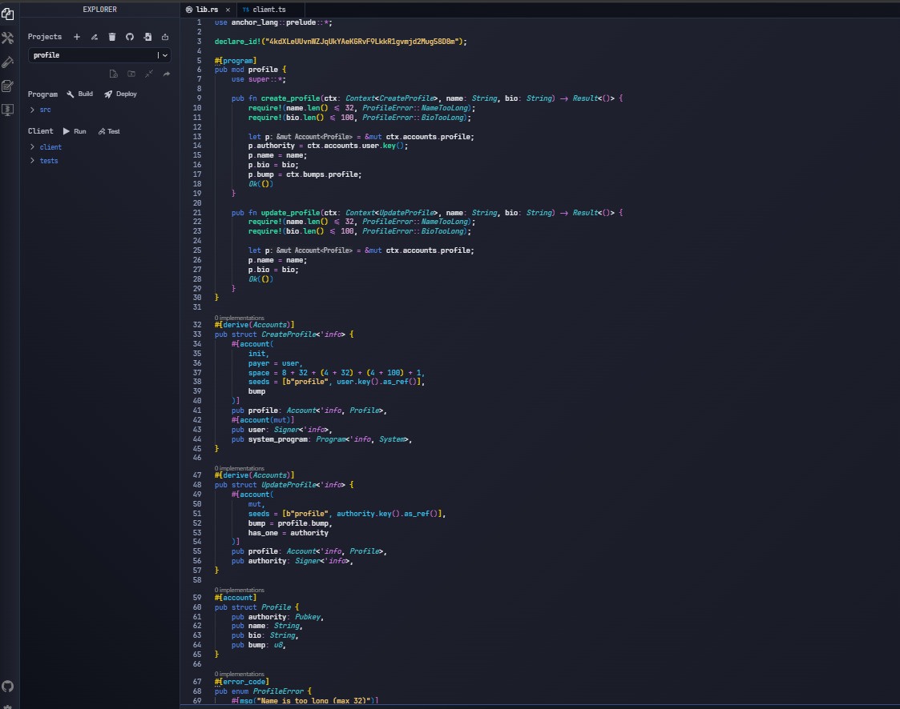

# Неделя 6: Accounts, PDAs и архитектура программ

**Тема:** децентрализованный on-chain профиль на основе PDA
**Результат обучения:** РО2
**Сеть:** Solana Devnet · **Среда:** Solana Playground

## Ход работы
1. В Solana Playground создан Anchor-проект `profile`; использован тот же Playground Wallet в Devnet.
2. Баланс проверен, при необходимости пополнен через [faucet.solana.com](https://faucet.solana.com).
3. Написана программа с инструкциями `create_profile` и `update_profile`.
4. Выполнены Build и Deploy.
5. Клиент `client.ts` вычисляет адрес PDA, создаёт профиль, читает его, обновляет и читает снова.
6. Транзакции и аккаунт PDA проверены в Solana Explorer.

## Как устроена программа
- Профиль хранится в PDA с seeds `["profile", user_pubkey]`: у каждого пользователя ровно один профиль.
- Поля `Profile`: `authority`, `name` (до 32), `bio` (до 100), `bump`.
- `update_profile` проверяет подпись владельца (`has_one = authority`) и адрес PDA (`seeds` + `bump`).
- Ошибки: `NameTooLong`, `BioTooLong`.

## Данные деплоя
| Параметр | Значение |
|---|---|
| Program ID | [4kdXLeUUvnWZJqUkYAeKGRvF9LkkR1gvmjd2Mug58D8m](https://explorer.solana.com/address/4kdXLeUUvnWZJqUkYAeKGRvF9LkkR1gvmjd2Mug58D8m?cluster=devnet) |
| Profile PDA | [EZJqDhHyGGHxQe1vpzer2Pyg7TKMgqnu15rBzPcsLTpk](https://explorer.solana.com/address/EZJqDhHyGGHxQe1vpzer2Pyg7TKMgqnu15rBzPcsLTpk?cluster=devnet) |
| Сеть | Devnet |

## Транзакции
- create_profile: [3vhTizKa...tB87](https://explorer.solana.com/tx/3vhTizKaTySrs88PtvKm11pwpmgbLw5bxvFLYVrtCTcg3XMYz2CQBCZRu52vNoVRNLASqVaHJGNJdU9vLDtUtB87?cluster=devnet)
- update_profile: [MfeTGCWC...wJD7F](https://explorer.solana.com/tx/MfeTGCWCX9F6DzM5BD2UMpG4yWr2cWgPjTnpbY9gbeMXW4woY22aRJw9ZVgusLf3GXW5BWDRweVfsDynYzwJD7F?cluster=devnet)

## Вывод клиента
```
Profile PDA: EZJqDhHyGGHxQe1vpzer2Pyg7TKMgqnu15rBzPcsLTpk
create tx: 3vhTizKaTySrs88PtvKm11pwpmgbLw5bxvFLYVrtCTcg3XMYz2CQBCZRu52vNoVRNLASqVaHJGNJdU9vLDtUtB87
before: Alice | Solana developer
update tx: MfeTGCWCX9F6DzM5BD2UMpG4yWr2cWgPjTnpbY9gbeMXW4woY22aRJw9ZVgusLf3GXW5BWDRweVfsDynYzwJD7F
after: Alice Updated | Learning Anchor and PDAs
```
Данные в PDA-аккаунте изменились после `update_profile`, что подтверждает корректную работу программы.

## Код
[src/lib.rs](src/lib.rs) · [client/client.ts](client/client.ts)

## Скриншоты




[← К списку работ](../README.md)
