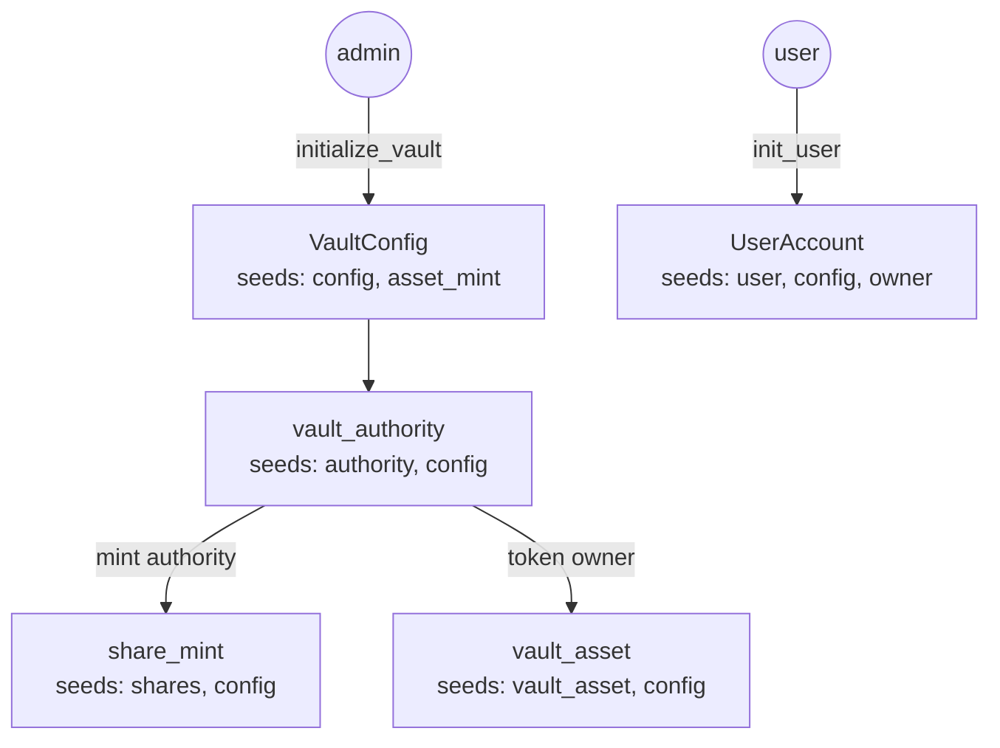

# Неделя 8: РК1 + BUILD SPRINT — каркас Liquidity Vault

**Тема:** старт сквозного проекта: аккаунт настроек, PDA пользователя и share-токен
**Результат обучения:** РО2
**Сеть:** Localnet / Solana Devnet · **Среда:** Anchor CLI 1.0.2

## Задание
На готовом шаблоне собрать каркас DeFi-vault: аккаунт настроек, PDA пользователя и share-токен. Подготовить ответы на вопросы РК1 по темам недель 1–7 → [rk1.md](rk1.md).

## Ход работы
1. Создан Anchor-workspace [`liquidity-vault/`](../liquidity-vault) (шаблон `anchor init`, Anchor 1.0.2).
2. Код программы разделён на модули: `state`, `constants`, `errors`, `events`, `instructions/`.
3. Описаны аккаунты `VaultConfig` и `UserAccount` (`#[derive(InitSpace)]` для расчёта места).
4. Реализованы инструкции `initialize_vault`, `init_user`, `update_settings`.
5. Написаны тесты [`tests/liquidity-vault.ts`](../liquidity-vault/tests/liquidity-vault.ts), запуск: `anchor test`.

## Архитектура каркаса



## Ключевые решения
- **Один vault на актив**: `VaultConfig` — PDA от `asset_mint`, поэтому адрес vault вычисляется детерминированно.
- **Отдельный `vault_authority`**: system-owned PDA без данных. Он владеет share mint и token account vault, а на неделях 10–13 подписывает CPI в Token program и Raydium. Так как у него нет данных, он может оплачивать rent за позицию Raydium (`authority_lamports` при инициализации).
- **Share-токен**: обычный SPL mint, `mint authority` = `vault_authority`, decimals совпадают с активом — первые доли выпускаются 1:1.
- **Безопасность**: `update_settings` защищена `has_one = admin`; все PDA проверяются через `seeds` + сохранённый `bump`.

## Код
- [lib.rs](../liquidity-vault/programs/liquidity-vault/src/lib.rs)
- [state.rs](../liquidity-vault/programs/liquidity-vault/src/state.rs)
- [initialize_vault.rs](../liquidity-vault/programs/liquidity-vault/src/instructions/initialize_vault.rs) · [init_user.rs](../liquidity-vault/programs/liquidity-vault/src/instructions/init_user.rs) · [admin.rs](../liquidity-vault/programs/liquidity-vault/src/instructions/admin.rs)

## Проверка
```bash
cd liquidity-vault && anchor test
```
Ожидаемый результат: 3 passing (`initialize_vault`, `init_user`, отказ `update_settings` для чужого кошелька).

## Данные деплоя
| Параметр | Значение |
|---|---|
| Program ID | _после `anchor deploy`_ |
| VaultConfig PDA | _после `initialize_vault`_ |

[← К списку работ](../README.md)
