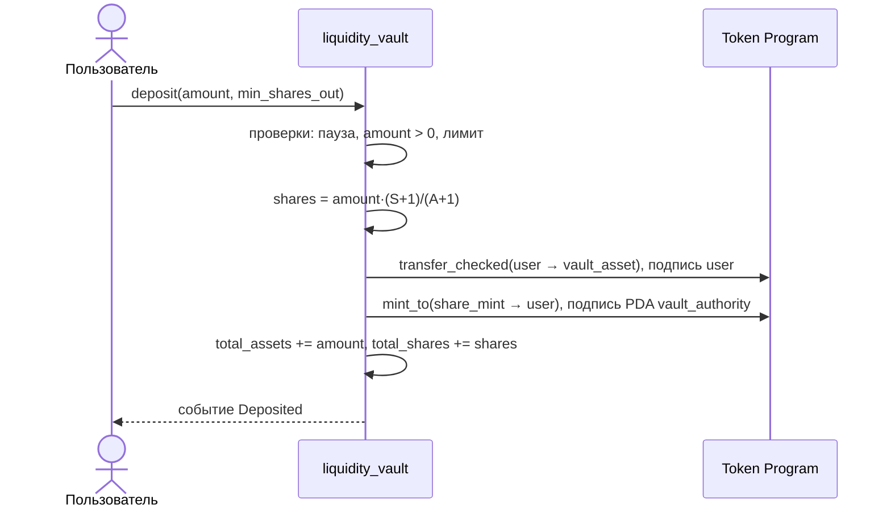

# Неделя 9: Vault — депозит и share-токены

**Тема:** пользователь вносит токены в vault и получает share-токены (свою долю)
**Результат обучения:** РО2
**Сеть:** Localnet / Solana Devnet · **Среда:** Anchor CLI 1.0.2

## Ход работы
1. Добавлен модуль [`math.rs`](../liquidity-vault/programs/liquidity-vault/src/math.rs) — расчёт долей без зависимостей от Anchor, с unit-тестами.
2. Реализована инструкция [`deposit(amount, min_shares_out)`](../liquidity-vault/programs/liquidity-vault/src/instructions/deposit.rs).
3. Добавлены ошибки `MathOverflow`, `DepositCapExceeded`, `ZeroShares`, `SlippageExceeded`, `Unauthorized` и событие `Deposited`.
4. Тесты дополнены сценариями депозита, паузы, лимита и проскальзывания.

## Как работает депозит



### Формула доли
```
shares = amount × (total_shares + 1) / (total_assets + 1)
```
- Первый депозит в пустой vault даёт доли **1:1**.
- Когда vault зарабатывает (растёт `total_assets`), за тот же депозит выпускается меньше долей — новые участники не «разбавляют» прибыль старых.
- Расчёт в `u128`, округление **вниз** (в пользу vault). Если выходит 0 долей — ошибка `ZeroShares`.
- `total_assets` — учётная величина, а не баланс token account. Прямой перевод токенов на `vault_asset` («донат») не меняет цену доли, поэтому классическая атака инфляции share-токена не работает.

### Проверки аккаунтов
- `config`: `seeds` + `bump`, `has_one = asset_mint / share_mint / vault_asset` — нельзя подставить чужой mint или vault.
- `user_asset_account`: `token::mint = asset_mint`, `token::authority = user`.
- `user_share_account`: ATA создаётся автоматически (`init_if_needed`) при первом депозите.
- `user_account`: PDA `["user", config, user]` и `owner == user`.

## Проверка

Unit-тесты математики (без валидатора):
```bash
cd liquidity-vault/programs/liquidity-vault && cargo test --lib math
```
```
test tests::first_deposit_is_one_to_one ... ok
test tests::proportional_after_first_deposit ... ok
test tests::share_price_grows_with_profit ... ok
test tests::rounds_down_in_favor_of_vault ... ok
test tests::no_overflow_on_large_values ... ok
test result: ok. 5 passed; 0 failed
```

Интеграционные тесты: `anchor test` — депозит 100 → 100 долей, повторный депозит 50 → 150 долей, отказы `SlippageExceeded`, `VaultPaused`, `DepositCapExceeded`.

## Данные деплоя
| Параметр | Значение |
|---|---|
| Program ID | _после `anchor deploy`_ |
| deposit tx | _после запуска клиента_ |

[← К списку работ](../README.md)
